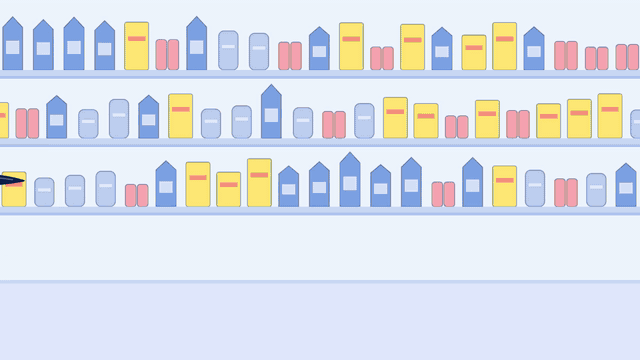
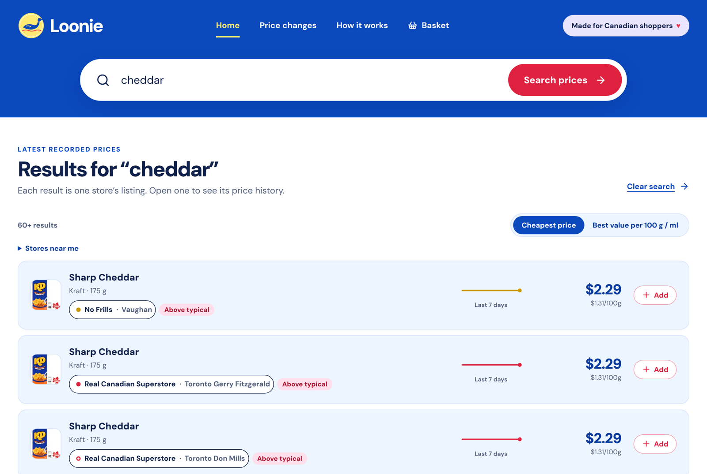
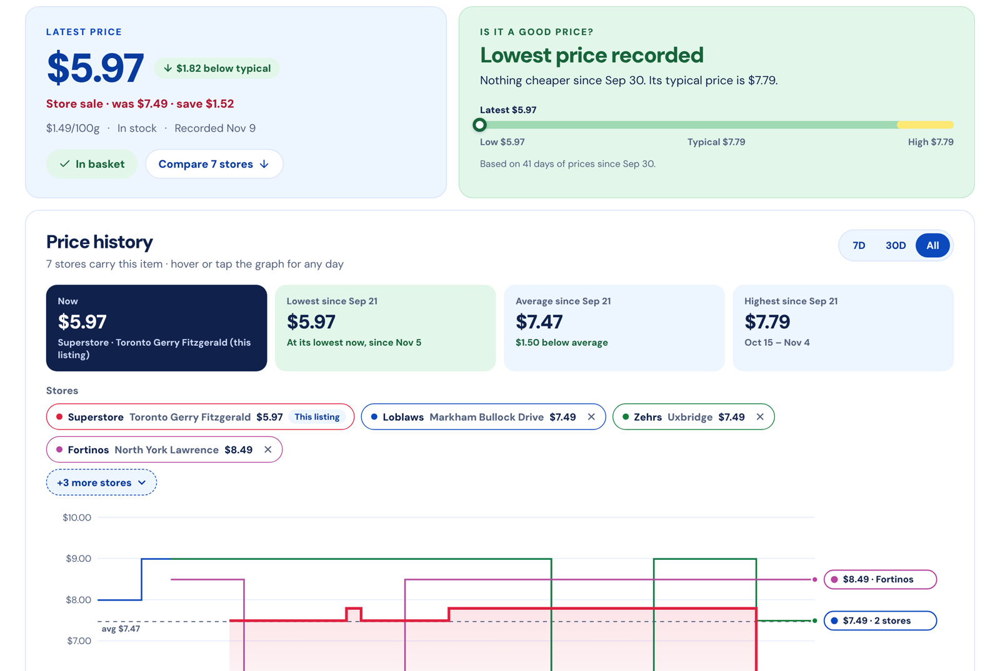
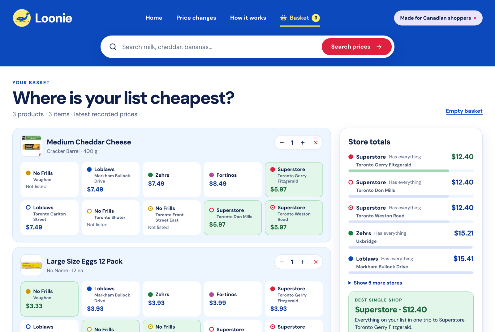
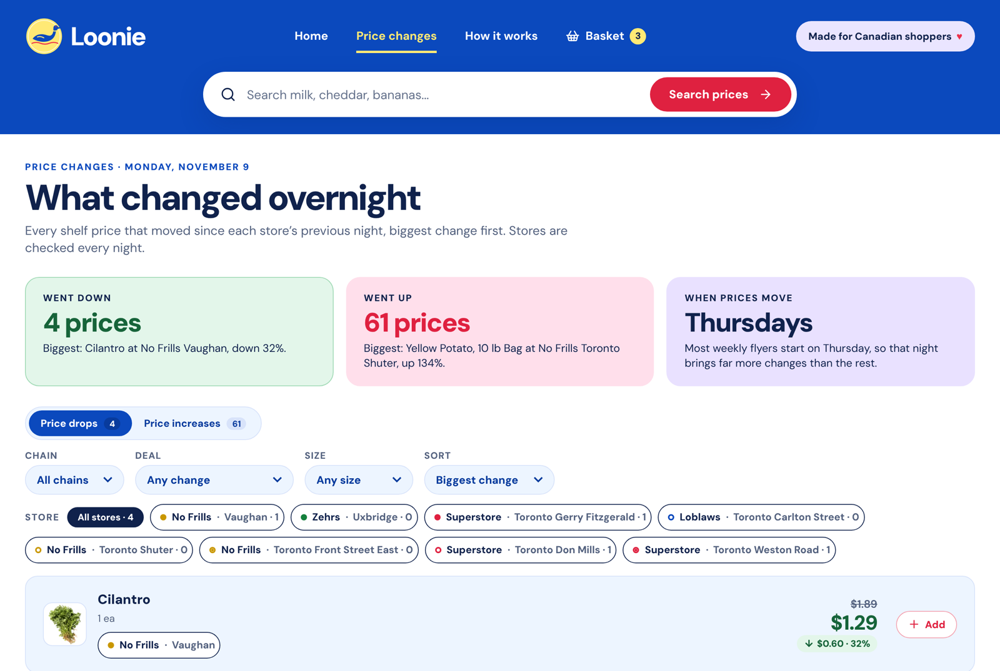
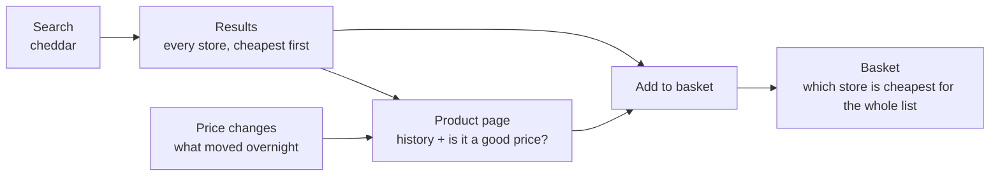
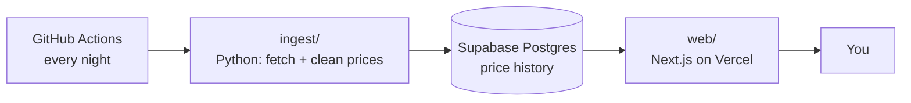

# Loonie

[](https://github.com/Ayaan2266/grocery-tracker/actions/workflows/ci.yml)
[](https://github.com/Ayaan2266/grocery-tracker/actions/workflows/ingest.yml)

**Know what groceries cost.** Loonie records the shelf price of every product
at ten Ontario grocery stores, every night, and keeps the history.



**Live:** _launching on Vercel in November 2026_

It answers two questions:

1. **Which store is cheapest for my list right now?**
2. **Is this "sale" actually a good price, or the normal price with a sticker on it?**

Flyer apps show what is on sale. Nobody keeps the history, so nobody can tell
you if the sale is real. That is the gap, and history cannot be added later:
it has to be collected one night at a time.

## What it looks like

| Search | Price history |
|---|---|
|  |  |
| Every store's latest price, with a 7-day trend and a badge. | The full history, and a verdict on today's price. |

| Basket | Overnight changes |
|---|---|
|  |  |
| Your list priced at each store, cheapest first. | Every price that went up or down last night. |

## How to use it



No account needed. The basket and your chosen stores are saved in a cookie.
Enter a postal code to see only the stores near you.

## How it works



1. **Fetch.** A scheduled job asks each store's website for its prices, at
   one request per second.
2. **Clean.** Prices become cents, and sizes become a unit price (per 100 g,
   per 100 ml, or each) so different packages can be compared.
3. **Store.** Only *changes* are saved, which takes 8.5x less space than a row
   per product per night. A database trigger stops any saved price from being
   edited.
4. **Show.** The site reads the database with a read-only key.

| Layer | Choice |
|---|---|
| Ingestion | Python 3.12, httpx, pydantic |
| Scheduler | GitHub Actions |
| Database | Supabase (Postgres) |
| Site | Next.js 15, TypeScript, plain CSS, Recharts |
| Hosting | Vercel |

Total cost: $0.

## Where things are

```
ingest/            the nightly job (Python)
  sources/         talks to the store API
  normalize.py     unit prices and validation
  match.py         finds the same product at different stores
  db.py            writes price changes
  targets.json     10 stores x 167 search terms
  tests/           runs offline
db/migrations/     the database schema, as numbered SQL files
web/               the site (Next.js)
  src/app/         pages: search, product, basket, changes, how it works
  src/lib/         queries, basket pricing, price verdicts; tests beside each
docs/              the longer write-ups, linked below
.github/workflows/ CI, and the nightly job with its weekly backup
```

## Run it yourself

**Ingestion**

```bash
cp .env.example .env          # fill in PCX_API_KEY and DATABASE_URL
python3.12 -m venv .venv && source .venv/bin/activate
pip install -e ".[dev]"

for f in db/migrations/*.sql; do psql "$DATABASE_URL" -v ON_ERROR_STOP=1 -f "$f"; done

python -m ingest.run --dry-run --limit 3 -v   # 10-second smoke test, writes nothing
python -m ingest.run                          # full run

ruff check ingest && pytest -q
```

**Site**

```bash
cd web
cp .env.example .env.local    # fill in the Supabase URL and anon key
npm install
npm run dev                   # http://localhost:3000

npm run lint && npm test && npm run build     # what CI runs
```

## Known limits

- **One company.** All five banners (No Frills, Superstore, Loblaws, Zehrs,
  Fortinos) are owned by Loblaw. No Walmart, Metro or Sobeys yet.
- **Ten stores, all in Ontario**, mostly in and around Toronto.
- **Short history.** Tracking started on 2026-09-21, so "lowest price
  recorded" means lowest since then. Each page says how many days it is
  based on.
- **Matching is cautious.** It would rather miss a match than pair two
  different products: it found 17 of 22 real matches in a hand-labelled test,
  with none wrong.

## Read more

| Doc | What is in it |
|---|---|
| [docs/architecture.md](docs/architecture.md) | The design decisions and why |
| [docs/data-sources.md](docs/data-sources.md) | The store API, as verified |
| [docs/operations.md](docs/operations.md) | Nightly schedule, deploying, backups, restoring |
| [docs/limitations.md](docs/limitations.md) | Unit prices and the full list of known limits |

## Legal

Personal, non-commercial project. Not affiliated with Loblaw Companies Limited
or any retailer. It uses an undocumented internal API, which is against
Loblaw's terms of service; requests are limited to about one per second, and
sustained 403s or a key rotation are treated as a stop signal.
